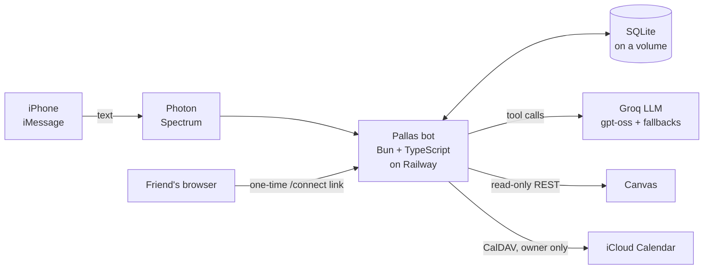
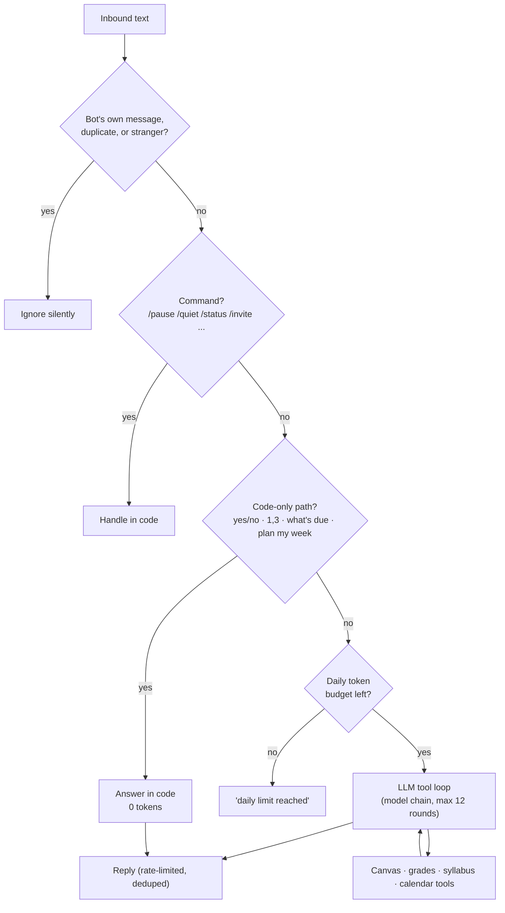

<p align="center"></p>

# Pallas

**An iMessage assistant that keeps your semester under control.** Text it "what's due this week?", "what do I need on the final to get an A?" or "what's the late policy in DATA 101?" and it answers from your live Canvas, in a few calm lines, with no app to open.

*Demo GIF coming soon (see [docs/DEMO.md](docs/DEMO.md) for how it's recorded with fake data).*

TypeScript on Bun · [Photon Spectrum](https://photon.codes) for iMessage · Groq (free tier) through the `openai` package · Canvas REST (read-only) · iCloud CalDAV · SQLite · deployed on Railway.

---

## What it does

| | |
|---|---|
| **Ask about Canvas** | Due dates, grades, announcements, assignments, answered from live data with tool calls. |
| **"What's due" for free** | Plain "what's due", "due this week", "due today", "/due" are answered **by code with zero AI tokens**, so they still work when the AI quota is gone. |
| **Grade calculator** | "What do I need on the final for an A?" is computed **in code**: group weights, drop-lowest rules, omitted and excused work, the course's own grading scale, points-based courses. It says plainly when a goal is impossible or already guaranteed, and checks its current grade against Canvas's. |
| **Ask my syllabus** | "Late policy?", "what's on the midterm?", "office hours?" are answered from the course's syllabus, front page and pages, via plain BM25 retrieval (no embeddings, no paid services): the model only sees the top 3 passages. If it isn't there, Pallas says so. |
| **Proactive** | Texts you new grades, announcements and 24h/3h deadline nudges; a morning brief (7am by default, `/brief` to change); an evening missing-work ping; a **Sunday 6pm preview** of the week ahead with grade changes. All plain code, grouped into one text per check. |
| **Calendar (owner only)** | Add, find, change, move and delete iCloud events; repeating events ("just this one or all of them?"); reminders; "edit that", "same again". **Nothing changes until you reply yes.** |
| **Study planner (owner only)** | "plan my week" finds free gaps in your calendar and proposes 1-2 hour study blocks before each deadline. You reply `all`, `1,3` or `none`. |
| **Multi-user** | Invite-only. Friends connect their own Canvas token through a one-time web link; each gets their own history, notifications and daily token budget. |
| **Resilient** | Fallback model chain on rate limits, honest 429 messages, per-user token caps, a single-instance lease, a circuit breaker on outgoing texts. |

Examples (what you text, what comes back):

```text
you:   what's due this week
pallas: Due through Sunday:
       Sat 1:55 PM - DATA 101: Lab 5: Regression
       Sun 7:55 AM - ECON 210: Problem Set 4

you:   what do I need on the final to get an A in econ 210
pallas: You need about 93.1% on the final for an A, if nothing else gets graded. Even a perfect
       final only reaches 95.4%, so it's possible but tight.

you:   remind me to submit the problem set Sunday 8am
pallas: Remind you to submit the problem set Sun 8am?
you:   yes
pallas: Okay, I'll remind you to submit the problem set Sun 8am (calendar alert).
```

(The examples use the fake demo data from `bun run demo`.)

---

## Architecture



**Design rule: code first, LLM where it earns its keep.** Anything with a right answer is computed in code (due lists, grade math, gap finding, retrieval, schedules, confirmations). The model routes requests to tools and phrases results.



A scheduler (every 30 minutes, per user, errors isolated) runs the notifications; the morning brief, evening missing-work check and Sunday preview are marked in SQLite so each goes out once.

---

## Commands

| Text | Does |
|---|---|
| `/due` | What's due (no AI) |
| `/status` | Uptime, messages sent, next check |
| `/quiet` | Toggle notifications |
| `/pause` · `/resume` | Ignore everything but `/resume` |
| `/reset` | Clear conversation history |
| `/disconnect` | Delete your token, history and settings (members) |
| `/invite` · `/users` · `/remove +1…` | Owner: manage friends |
| `/contact` | Owner: a 7-day link that adds Pallas to your Contacts (vCard with your assigned number and the app icon). New sign-ups get the same link on the /join page and in the welcome text |
| `/name Aarav Parakh` | Set what Pallas calls you, here and on your own Photon profile (one word = first name only; no argument shows the saved name) |
| `my classes` + one class per line | Save your schedule (read back first, saved on `yes`). Also `/classes`, `/classes add\|edit\|remove\|clear` |
| `/brief 7:00` · `/brief off` | Morning brief time (default 7:00 AM, 5–11 AM allowed); sent once a day, with a 3-hour catch-up window |
| `my gpa` · `/gpa` | Projected UNC term GPA from your current Canvas grades (no AI). `/gpa set 3.52 45` adds your cumulative; `ECON 210 is 4 credits` or `/credits ECON 210 4` sets credit hours (default 3, noted in the reply). What-ifs: `what if I get a B in ECON`, `what do I need in DATA 101 to keep a 3.5` |
| `/classalerts` | Toggle a heads-up 15 minutes before each class |
| `/skip YYYY-MM-DD` · `/unskip YYYY-MM-DD` | Mark a day with no class / hold class on a university no-class day |

### Class schedules

Any user can text lines like `DATA 101 MWF 9:05-9:55 Sterling 120`. Pallas reads them back and saves only after `yes`. Days (`MWF`, `TTh`, `Tu/Th`), times without am/pm (9-11 morning, 1-7 afternoon) and `.001` section suffixes are handled in code; a messy paste is the only case that uses the model, once. Term dates and UNC's no-class days live in `src/terms.ts` (Fall 2026 only; add a `term YYYY-MM-DD to YYYY-MM-DD` line for another term). "Next class", "classes today/tomorrow" and "where is ECON 210" are answered with no LLM. Classes lead the morning brief, are added to deadline nudges ("ECON 210 meets 11:00 AM that day"), and count as busy time for the study planner. The owner is also offered weekly repeating iCloud events (holidays excluded, never duplicated).

---

## Setup

**You need:** [Bun](https://bun.sh), a Canvas access token (Account → Settings → *+ New Access Token*; Pallas only makes read-only GET requests), a free [Groq](https://console.groq.com) key, and a [Photon](https://photon.codes) project for iMessage.

```sh
bun install
cp .env.example .env     # fill in CANVAS_TOKEN, LLM_API_KEY, ALLOWED_SENDERS (+ Photon credentials for iMessage)
bun run src/index.ts     # PROVIDER=terminal (default): chat in a local TUI, no credentials needed
```

| `PROVIDER` | Where it listens |
|---|---|
| `terminal` | A local chat window. Good for trying things. |
| `local` | Your Mac's Messages app (needs Full Disk Access; the Mac must stay awake). |
| `cloud` | A Photon iMessage line. Add each person's number under *Users* in the Photon dashboard. |

Try it on your real data **without sending anything or calling the AI**: `bun run dry-run` (forces every scheduled job once and prints the texts), or `bun run src/index.ts --dry-run --grade "ECON 210" --target A`.

### Configuration

| Variable | Purpose |
|---|---|
| `CANVAS_URL`, `CANVAS_TOKEN` | Your school's Canvas and your token (the owner's) |
| `GROQ_API_KEY` (or the older `LLM_API_KEY`), `CEREBRAS_API_KEY` | Keys for the provider chain; a provider without a key is skipped |
| `LLM_PROVIDERS` | The chain, e.g. `groq:openai/gpt-oss-120b,cerebras:gpt-oss-120b` (default), or a JSON array of `{provider, baseUrl, keyEnv, model}` |
| `LLM_BASE_URL`, `LLM_MODEL`, `LLM_MODELS` | Groq's endpoint and models, e.g. `LLM_MODELS=openai/gpt-oss-120b,openai/gpt-oss-20b` (these still work) |
| `ALLOWED_SENDERS` | Comma-separated numbers/emails; the first is the **owner** |
| `PROVIDER`, `SPECTRUM_PROJECT_ID`, `SPECTRUM_PROJECT_SECRET` | iMessage transport |
| `TIMEZONE`, `BOT_NAME` | Defaults `America/New_York` and `Pallas` |
| `ICLOUD_EMAIL`, `ICLOUD_APP_PASSWORD` | Calendar features (an Apple app-specific password) |
| `PUBLIC_URL`, `ENCRYPTION_KEY`, `ALLOWED_CANVAS_HOSTS` | Turn on multi-user (below) |
| `PHOTON_USER_LIMIT` | Most people the Photon plan allows (default 10 on Free; set 100 for Pro) |
| `OWNER_NAME` | How the first text names whoever invited someone ("Sam invited you"; default "a friend") |
| `LLM_DAILY_TOKENS_OWNER`, `LLM_DAILY_TOKENS_PER_USER` | Daily token caps (100K / 50K) |
| `LLM_REASONING_EFFORT`, `LLM_MAX_OUTPUT_TOKENS` | `low` and `1500` by default |
| `DB_PATH`, `PORT` | SQLite file and the connect page's port |

### Multi-user

Set `PUBLIC_URL` (https) and `ENCRYPTION_KEY` (`openssl rand -base64 32`; back it up, since losing it makes stored tokens unreadable). Without those two variables the bot behaves as a single-user bot.

**Inviting someone.** Text `/invite` for a single-use, 7-day link like `PUBLIC_URL/join/CODE`, and forward it. The person opens it, enters their first and last name, email and US mobile number (all required, validated with inline errors), and:

1. the number is enrolled on the Photon (Spectrum) shared plan through its API (`POST /projects/{id}/users/` with their name and email, Basic auth with `SPECTRUM_PROJECT_ID` and `SPECTRUM_PROJECT_SECRET`), which also assigns them the number they text;
2. Pallas tries to text them first ("Hi Jordan, I'm Pallas. Sam invited you. Connect your Canvas here: …", with a private connect link, one use, 30 minutes). Photon's shared plan only lets Pallas message someone who has texted it first, so if that is refused the failure is logged (number masked), the send is retried every 10 minutes (6 tries), and the join page never claims it worked. The page always shows "Text Pallas to get started" with the number Photon assigned them and an **Open Messages** button (`sms:<number>&body=hi`) that opens Messages with "hi" typed. When they text, Pallas replies with the welcome and their connect link. The connect token is never on the web page;
3. they paste their Canvas token on a simple page and are connected.

The join page is rate limited per IP and per code. Before enrolling, Pallas counts active Photon users against `PHOTON_USER_LIMIT`; if the plan is full the page says "Pallas is full right now", the invite is kept, and the owner gets "Invite failed: Photon user limit reached." (at most once an hour). If the count can't be read, a limit-style refusal from Photon is treated the same way. `/remove` and `/disconnect` delete the user from Photon, which frees the slot. Someone whose number is already enrolled can still text `join CODE`. Name and email live on the user's row and are deleted by `/disconnect` and `/remove`; people added in the Photon dashboard keep their Photon record untouched and can set a name for Pallas with `/name Aarav` (first name only) or `/name Aarav Parakh` (anything after the first word is the last name). The Spectrum API has no update-user call, so Pallas uses the documented behaviour of re-posting an existing shared user's phone, which updates the name. It only ever does this for the person running `/name`, on their own already-enrolled number (never anyone else's, and it never creates a user); if Photon can't be updated the reply says so. Logs mask phone numbers (`+1919•••0142`) and never contain an email.

### Deploy on Railway

One service, **one replica**, a **volume at `/data`** (`DB_PATH=/data/canvas-bot.db`), variables from `.env.example`, and a public domain for the connect page (`PORT=8080`). Pushes to `main` auto-deploy. The bot also holds a lease in the database, so a second copy can never answer at the same time. Logs and restarts live in the Railway dashboard (service → Deployments → ⋮); text `/status` to check it's alive. `railway.json` is deprecated by Railway after 2026-12-01: migrate with `railway config migrate` and keep the `/data` volume declared (an omitted resource is deleted on apply).

---

## Security notes

- **Tokens are encrypted at rest:** members' Canvas tokens use AES-256-GCM (WebCrypto) with `ENCRYPTION_KEY`; a fresh random IV each time, tamper-evident. Tokens are never logged.
- **One-time connect links:** 32 random bytes, only a SHA-256 hash is stored, single use, 30-minute expiry, five wrong tries burn the link, and a GET (or an iMessage link preview) never consumes it.
- **No SSRF:** the connect page only ever contacts hosts in `ALLOWED_CANVAS_HOSTS`, over https, without following redirects.
- **Hardened page:** `Cache-Control: no-store`, `Referrer-Policy: no-referrer`, a strict nonce-based CSP, everything HTML-escaped.
- **Invite-only access:** unknown senders get no reply at all; a wrong invite code gets one short message, then silence after five tries an hour.
- **Owner-only calendar:** calendar, reminders and the planner are not offered to members, refused if requested, and refused again inside the calendar module itself. Only calendars you own can be edited (subscribed feeds and calendars shared with you are left alone).
- **Nothing silent:** every calendar change, reminder and study block is staged and confirmed first.
- **Read-only Canvas client,** per-user context (a request can only ever use its own user's token), a circuit breaker on outgoing messages, message de-duplication, and a single-instance lease.

---

## The model chain

Pallas doesn't depend on one LLM provider. `src/llm.ts` runs each request through a chain of OpenAI-compatible providers, by default **Groq `openai/gpt-oss-120b`, then Cerebras `gpt-oss-120b`**. It falls over to the next entry on a 429, a 5xx, a timeout or dropped connection, a daily cap, or a bad key. A provider that hits its daily cap is remembered until its reset instead of being retried on every message. A 400 caused by our own request never falls over (it would fail everywhere); it is surfaced and fixed. Requests are paced per model (Cerebras `gpt-oss-120b` allows 5/min, so one request goes out every 12 s) and a reply that would wait more than 5 s skips to the next entry. If nothing can answer, the user gets "I'm having trouble thinking right now, try again in a minute".

Differences between providers are handled per provider, so Groq's request is untouched: Cerebras gets plain tool schemas (no `["string","null"]` unions) and messages with only the standard fields. Usage is tracked per provider and model each (UTC) day, and the log says which provider answered each message (no content, numbers masked). The owner can text `/llm` to see each entry's state and usage, and `/llm off groq` (then `/llm on`) to rehearse a failover without touching any key. `scripts/token-meter.ts` prints what each provider can carry per day; `scripts/llm-eval.ts` is a 10-prompt quality check on fake data for adding a model to the default chain.

## Cost and limits (the Groq free tier)

Groq's free tier gives an organization about **200,000 tokens/day** and **8,000/minute** per model. Every model round re-sends the system prompt and tool schemas, so cost is mostly *rounds*. After the key hit its daily cap, I measured and cut it:

| Question | Before | Now |
|---|---|---|
| "what's due this week" | ~24,300 tokens (12 rounds, one per course) | **0** (answered by code) · ~1,700 if it goes through the model |
| "what's my grade in ECON 210" | ~3,300 | ~1,900 |
| "what do I need on the final for an A" | n/a | ~1,900 (math in code, model phrases it) |
| "late policy in DATA 101" | n/a | ~1,700 (top 3 passages, ≤ 2,400 chars) |
| "remind me to … tomorrow 8pm" | n/a | ~2,900 (calendar tools loaded) |
| small talk | ~1,500 | ~800 |
| plain "plan my week", morning brief, Sunday preview, nudges, yes/no/`1,3` replies | n/a | **0** |

Estimates from `bun scripts/token-meter.ts`, which replays a question against real data and counts the real request size (no AI calls). **Tool gating:** the owner's calendar, reminder and planner tools (~half of every request) are only sent when a message looks calendar-related, so a Canvas question costs ~600 tokens per round instead of ~1,180. The detector errs toward "yes"; if it misses, the model can still call a tool by name (or say it can't) and the turn is retried once with everything loaded.

What keeps it inside the free tier: the composite `get_due_overview` tool, calendar tools loaded only when needed, low reasoning effort for gpt-oss models, an output cap, trimmed history and tool results, daily caps (owner 100K, members 50K), a **fallback model chain** (limits are per model, so each fallback has its own budget), and honest errors: a 429 is logged with Groq's full message, a per-minute limit gets one short retry, and a daily limit tells you when to try again. Tests mock the LLM and refuse to call the real one.

---

## Project layout

| Path | What's there |
|---|---|
| `src/index.ts` | Wiring: provider, scheduler, web server, lease, shutdown |
| `src/handler.ts` | The message pipeline: commands, confirmations, fast paths, budget, agent |
| `src/agent.ts` | System prompt, tool loop, model chain, 429 handling |
| `src/canvas.ts` · `assignments.ts` | Canvas client, "what's due" |
| `src/grades.ts` | Grade calculator (pure functions + report) |
| `src/syllabus.ts` | Chunking, BM25 retrieval, per-course cache |
| `src/gpa.ts` | UNC GPA: scale, credit weighting, cumulative, what-if solver, syllabus-scale parsing |
| `src/classes.ts` · `terms.ts` | Class schedules: parsing, read-back, fast answers, heads-ups; term dates |
| `src/calendar.ts` · `planner.ts` | iCloud events, reminders, confirmations; study planner |
| `src/notify.ts` | Scheduler, morning brief, Sunday preview, nudges, grade/announcement alerts |
| `src/db.ts` · `crypto.ts` · `users.ts` · `web.ts` | SQLite + migrations, encryption, per-user context, connect page |
| `scripts/` | `token-meter.ts` (cost estimates), `demo-canvas.ts` + `demo.ts` (fake Canvas for demos) |
| `tests/` | 160+ tests; everything mocked (LLM, Canvas, CalDAV) |

`bun test` runs the suite, `bunx tsc --noEmit` the typecheck.

## Limits and roadmap

- **PDFs aren't read yet.** Many instructors post the syllabus as a PDF; Pallas tells you when a course has no readable text. To add them: list `/courses/:id/files`, download the PDF, extract text (e.g. `pdf-parse`) and feed it to the same `chunkText` and cache.
- **Embeddings** could replace or blend with BM25: store a vector per passage in `syllabus_chunks` and rank by cosine similarity. Retrieval is one function (`rank(query, chunks)`).
- **iCloud Reminders can't be written over CalDAV** on at least some accounts (the server accepts a reminder with HTTP 201 and never stores it), so a reminder is a calendar event titled `Reminder: …` with a display alarm.
- **Grades are as good as Canvas's data:** instructors who grade outside Canvas, or set odd group weights, can make any projection approximate. Pallas flags unusual setups (for example weights that add up to 140%) and shows its work.

## Publishing a showcase copy

The working repository keeps its full history. To share the project, `scripts/publish-showcase.sh` exports what is committed at `HEAD`, replaces real identifiers with fictional ones (`scripts/scrub.ts` and a local, gitignored `.scrub.local` mapping), scans the result for anything personal (and aborts if it finds any), and force-pushes **one fresh commit** with no history to a separate repo (`pallas` by default; created private if it doesn't exist). It never changes visibility. `DRY_RUN=1` builds and scans without pushing. Run it again whenever you want the showcase refreshed.
